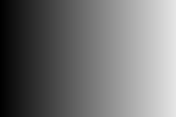
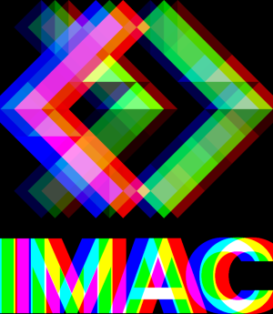
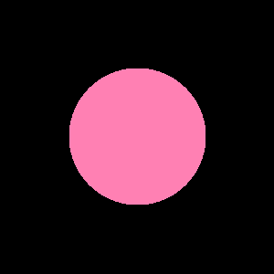
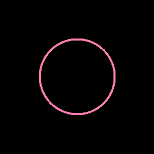
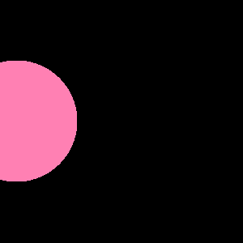
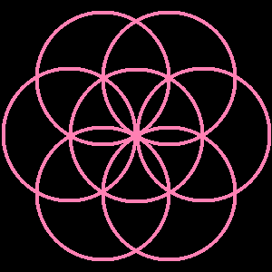
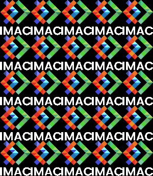
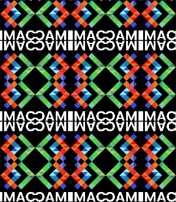
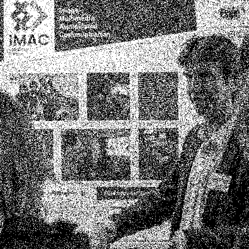

# 🐣 S1 | Prog: Workshop

## ⭐ Ne garder que le vert


Image d'origine

</br>


</br>

## ⭐ Échanger les canaux


Image d'origine

</br>


</br>

## ⭐ Noir & Blanc


Image d'origine

</br>


</br>

## ⭐ Négatif


Image d'origine

</br>


</br>

## ⭐ Dégradé



</br>

## ⭐⭐ Miroir


Image d'origine

</br>


</br>

## ⭐⭐ Image bruitée


Image d'origine

</br>


</br>

## ⭐⭐ Rotation de 90°


Image d'origine

</br>


</br>

## ⭐⭐ RGB split


Image d'origine

</br>



</br>

## ⭐⭐ Luminosité


Image d'origine

</br>


</br>

## ⭐⭐(⭐) Disque



</br>

### ⭐⭐ Cercle



</br>

### ⭐⭐ Animation



</br>

### ⭐⭐⭐ Rosace



</br>

## ⭐⭐ Mosaïque


Image d'origine

</br>



</br>

### ⭐⭐⭐⭐ Mosaïque miroir


Image d'origine

</br>



</br>

## ⭐⭐⭐(⭐) Tramage


Image d'origine

</br>


Pour le tramage, j'ai utilisé la matrice Bayer de niveau 1 (4x4) dont l'article parlait (j'ai pu récupérer les valeurs claires de la matrice sur Wikipédia). L'algorithme parcourt l'ensemble des pixels de l'image, et lui assigne une valeur de 0 ou 1 selon sa luminosité une fois multipliée par la valeur correspondante de la matrice.

Il m'a suffit d'ajouter ces lignes dans la boucle `for` des `y` pour appliquer la formule indiquée dans l'article :
``` cpp
float brightness = 0.2126 * color.r + 0.7152 * color.g + 0.0722 * color.b;
const float output_color = brightness + (bayer_matrix_4x4[x % bayer_n][y % bayer_n]);
```
où `bayer_n` = la largeur de la matrice (ici 4), puis de mettre les valeurs `r`, `g` et `b` à `0.f` si le résultat était strictement inférieur à 0.5, ou à `1.f` dans le cas contraire.

J'ai également codé la "map" de bruit blanc que l'article détaillait en premier, grâce à ce code :
``` cpp
float brightness = 0.2126 * color.r + 0.7152 * color.g + 0.0722 * color.b;
float random_value = random_float(0.f, 1.f);
```

qui prend une valeur aléatoire entre 0 et 1 et regarde si la luminosité du pixel est plus grande (assigne 1) ou plus petite (assigne 0). Les pixels déjà clairs restent clairs et les pixels foncés restent foncés, mais le résultat (ci-dessous) est beaucoup moins clair que le tramage via la matrice Bayer.



Dans ma fonction `dither`, on peut préciser si on veut utiliser la "map" de matrice Bayer (`bayer`) ou de bruit blanc (`white noise`).

</br>

## ⭐⭐⭐⭐ Convolutions


Image d'origine

</br>


Pour les convolutions, ces 2 lignes de code me permettent de ne pas utiliser de conditions pour savoir si le pixel du kernel fait partie ou non de l'image d'origine

``` cpp
int const neighbor_x = std::max(0, std::min(x + kx - radius, image.width() - 1));
int const neighbor_y = std::max(0, std::min(y + ky - radius, image.height() - 1));

sum += kernel[kx][ky] * original.pixel(neighbor_x,neighbor_y);
```

`radius` = la moitié de la longueur du kernel arrondie à l'inférieur, de sorte à ce que `x + kx - radius` corresponde à `x-1`, `x` ou `x+1` selon la valeur de `kx` (pour un kernel de 3x3). Idem pour `y`.

Pour les valeurs `x`, on vérifie ensuite si ce pixel voisin de `x` ne déborde pas à droite de l'image. On prend la valeur minimum entre la valeur `x` du voisin (qu'on a calculée juste avant) et la largeur de l'image moins 1. Dans le cas où le `x` du voisin dépasse la largeur moins 1 (et soit donc en dehors de l'image), on s'arrête et on prend la largeur moins 1.

Ensuite on vérifie si elle ne dépasse pas par la gauche. C'est à ça que sert le `std::max`, qui nous permet de prendre la valeur maximum entre 0 et le minimum qu'on a retenu précédemment. Si la valeur de `x` du voisin est négative (donc elle n'est pas dans l'image), on garde directement 0.

Le principe est le même pour les valeurs `y`. On a donc directement toutes les valeurs des voisins du pixel `(x,y)` qui sont inclus dans l'image sans utiliser de conditions.

</br>

### ⭐ Netteté, Contours, etc.


Image d'origine

</br>


Il suffit de faire passer n'importe quel kernel (vecteur de vecteurs de flottants de largeur `2 * radius + 1`) dans la fonction `convolution` pour appliquer n'importe quel effet de convolution à l'image. J'ai récupéré les kernels pour l'embossage, les contours et la netteté.